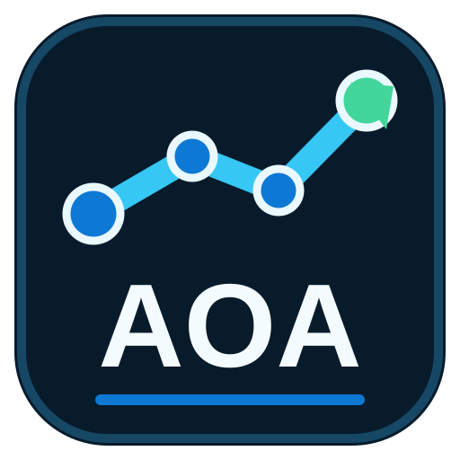

# AOA — planowanie i optymalizacja produkcji



AOA jest lokalną aplikacją desktopową i terminalową do planowania produkcji,
porównywania heurystyk harmonogramowania, analizy danych oraz przygotowywania
raportów. Projekt działa offline, zapisuje dane użytkownika lokalnie i nie wymaga
zewnętrznej usługi do podstawowej pracy.

- Aktualna wersja: **0.10.0**
- Python: **3.11–3.14**
- Interfejs: **CustomTkinter**
- Repozytorium: **https://github.com/Kitori777/AOA**

## Najważniejsze możliwości

- Auto Kolejka z porównaniem wszystkich zarejestrowanych heurystyk STO.
- Dwustopniowe planowanie:
  1. kontrola kompletności komponentów,
  2. przydział operacji do maszyn i wyznaczenie dokładnych godzin.
- Reakcja na niedostępność maszyny bez ukrywania niewykonalnych operacji.
- Tryb ciągły oraz zatwierdzany plan tygodniowy.
- Zależności między operacjami, dozwolone maszyny i zamrożone pozycje planu.
- Analizy scenariuszy „co-jeśli”, historia przebiegów i audyt zmian.
- Modele jakości, opóźnień i strategii harmonogramowania.
- Visual Lab, Results Studio, raporty HTML/PDF i diagramy.
- Lokalna asystentka ALICE objaśniająca wyniki i obsługę programu.
- GUI oraz rozbudowane polecenia CLI do automatyzacji pracy.

## Auto Kolejka

Auto Kolejka korzysta z pliku `schedule.csv`. Jeśli obok znajdują się pliki
`bom.csv` i `inventory.csv`, aplikacja najpierw sprawdza oraz rezerwuje
komponenty dla całego zlecenia. Dopiero zlecenia możliwe do wykonania są
przekazywane do dokładnego harmonogramowania operacji.

### Kolejka 1 — komponenty

Każde zlecenie otrzymuje jeden z trzech stanów:

| Stan | Znaczenie |
|---|---|
| `READY` | wszystkie komponenty są dostępne teraz |
| `WAITING_COMPONENTS` | komplet będzie dostępny w potwierdzonym terminie |
| `UNSCHEDULABLE` | brak komponentu lub potwierdzonej dostawy |

Brak jednej pozycji nie zatrzymuje pozostałych zleceń. Problem pozostaje
widoczny w kolejce i w liczniku braków.

### Kolejka 2 — maszyny i czas

Drugi etap wybiera kolejność, maszynę oraz godzinę rozpoczęcia każdej operacji.
Uwzględnia między innymi:

- terminy realizacji i priorytety,
- poprzedniki operacji,
- czas produkcji i przezbrojenia,
- dostępność komponentów,
- listę dozwolonych maszyn,
- maszyny oznaczone jako niedziałające,
- zamrożone i rozpoczęte operacje.

Ranking heurystyk jest liczony na podstawie dokładnego planu operacji, dlatego
liczba niewykonalnych pozycji w rankingu i tabeli maszyn jest zgodna.

## Plan tygodniowy

Tryb tygodniowy upraszcza pracę planisty, oddzielając stabilny tydzień
produkcyjny od planów, które nadal można optymalizować.

Domyślna polityka:

- początek tygodnia: poniedziałek, 06:00,
- kalendarz: pięć dni po osiem godzin,
- strefa czasowa: `Europe/Warsaw`,
- horyzont produkcyjny: 40 godzin.

Przepływ pracy:

1. Wybierz tryb **Tygodniowy**.
2. Użyj **Przygotuj następny tydzień**.
3. Sprawdź operacje, maszyny i godziny.
4. Użyj **Zatwierdź tydzień**.
5. Po rozpoczęciu tygodnia jego operacje są automatycznie zamrażane.
6. Nowe zlecenia są planowane dopiero poza aktywnym horyzontem.

Awaria maszyny lub nowy brak materiałowy generuje alert, ale nie przesuwa
samoczynnie zatwierdzonego planu. Zmiana aktywnego tygodnia wymaga działania
**Awaryjnie przeplanuj**, potwierdzenia i podania powodu. Poprzednia wersja
pozostaje w historii audytu.

Tryb **Ciągły** zachowuje dotychczasowe zachowanie i przelicza kolejkę po zmianie
danych, ustawień lub stanu maszyny.

## Szybki start

### Wymagania

- Windows 10/11, Linux lub macOS,
- Python 3.11–3.14,
- zalecany menedżer środowiska `uv`.

### Instalacja z `uv`

```powershell
git clone https://github.com/Kitori777/AOA.git
cd AOA
uv sync --all-groups
uv run aoa
```

Uruchomienie CLI:

```powershell
uv run aoa-cli --help
```

### Instalacja bez `uv`

```powershell
python -m venv .venv
.\.venv\Scripts\Activate.ps1
python -m pip install --upgrade pip
python -m pip install -e .
aoa
```

Narzędzia deweloperskie:

```powershell
python -m pip install pytest pytest-cov ruff mypy pre-commit pyinstaller
```

## Dane wejściowe Auto Kolejki

Minimalny plik `schedule.csv`:

```csv
zlecenie_id,czas_produkcji_h,termin_h,status
Z-001,4,12,NEW
Z-002,2.5,8,NEW
```

Najważniejsze pola rozszerzone:

| Pole | Zastosowanie |
|---|---|
| `operation_id` | unikalny identyfikator operacji |
| `predecessors` | identyfikatory poprzedników rozdzielone `\|` |
| `dozwolone_maszyny` | numery maszyn, np. `1\|3` |
| `produkt_id`, `ilosc_szt` | wejście do kontroli BOM i magazynu |
| `czas_przezbrojenia_h` | czas przygotowania maszyny |
| `components_ready_h` | godzina potwierdzonej gotowości materiałów |
| `frozen`, `started` | blokada lub rozpoczęcie operacji |
| `fixed_machine_id` | przypisana maszyna dla pozycji zablokowanej |
| `fixed_start_h` | niezmienna godzina startu |
| `status` | `NEW`, `PLANNED`, `IN_PROGRESS`, `DONE` lub `BLOCKED` |

Kompletny, działający przykład znajduje się w
[`data/sample/schedule.csv`](data/sample/schedule.csv). Przykładowe dane BOM i
magazynu znajdują się w tym samym katalogu.

## CLI

Główne grupy poleceń:

```text
generate      generowanie danych
train         trening modeli ML lub STO
solve         użycie zapisanego modelu
sto-run       ręczna analiza harmonogramowania
workflow      pełny przepływ generate → train → solve
analytics     analiza danych bez GUI
report        budowanie raportu
diagram       generowanie diagramu
alice         pytanie do ALICE
interactive   interaktywny tryb terminalowy
```

Przykład:

```powershell
uv run aoa-cli sto-run `
  --jobs Z1,Z2,Z3 `
  --times 10,20,100 `
  --deadlines 150,30,110 `
  --methods MT,MO,MZO
```

## Architektura

```text
src/AOA/
├── app.py                 punkt wejścia GUI
├── cli/                   polecenia terminalowe
├── core/
│   ├── planning/          operacje, walidacja, harmonogram i plany tygodniowe
│   ├── optimization/      cele oraz heurystyki optymalizacyjne
│   ├── history/           przebiegi i łańcuch audytu
│   ├── reliability/       kopie, diagnostyka i odzyskiwanie
│   ├── storage/           atomowy zapis lokalny i granica synchronizacji
│   ├── queue_service.py   dwukolejka i zapis wyników
│   └── component_inventory.py
├── gui/                   strony i okna CustomTkinter
├── platform/              ścieżki wersji źródłowej i instalowanej
└── settings.py            trwałe ustawienia aplikacji
```

Warstwy są rozdzielone tak, aby planowanie można było testować bez uruchamiania
interfejsu. GUI wywołuje te same serwisy, które są dostępne dla CLI i testów.

Więcej informacji: [`docs/architecture.md`](docs/architecture.md),
[`docs/guide.md`](docs/guide.md) i [`docs/theory.md`](docs/theory.md).

## Dane i prywatność

AOA domyślnie pracuje offline. Wersja instalowana zapisuje dane robocze w
`%LOCALAPPDATA%\AOA`, a ustawienia w `%APPDATA%\AOA`. Pliki dołączone do
instalacji są traktowane jako zasoby tylko do odczytu.

Integracja SharePoint pozostaje wyłączona, dopóki użytkownik nie włączy usług
online. Sam adapter nie oznacza automatycznego przesyłania danych.

Plany tygodniowe są zapisywane wersjami. Zatwierdzenie i awaryjne przeplanowanie
trafiają do łańcucha audytu zabezpieczonego skrótami.

## Jakość i testowanie

```powershell
uv run pytest -q --basetemp=.pytest-run\full
uv run ruff check src tests
uv run mypy
python -m compileall -q src
```

Testy obejmują logikę planowania, komponenty, niedostępność maszyn, trwałość
danych, scenariusze, GUI oraz zgodność starszych przepływów.

## Budowanie wersji Windows

Skrypty wydania znajdują się w `scripts`, a definicje pakowania w `packaging`.

```powershell
.\scripts\build_desktop.ps1
.\scripts\smoke_desktop.ps1
```

Samo utworzenie instalatora nie jest traktowane jako pełna weryfikacja wydania.
Przed publikacją należy uruchomić test wersji spakowanej, instalację oraz
porównanie kontrolnych plików źródłowych i zainstalowanych.

## Struktura repozytorium

| Katalog | Zawartość |
|---|---|
| `src/AOA` | kod aplikacji |
| `tests` | testy automatyczne |
| `data/sample` | kontrolowane dane demonstracyjne |
| `docs` | instrukcje, teoria i architektura |
| `scripts` | budowanie, smoke testy i generatory |
| `packaging` | konfiguracja PyInstaller i Inno Setup |
| `models` | lokalne modele użytkownika, bez publikowania w Git |

Katalogi `build`, `dist`, cache testów, logi i wyniki `*_latest.csv` są
artefaktami lokalnymi i nie należą do historii repozytorium.

## Rozwój projektu

1. Utwórz gałąź roboczą.
2. Dodaj lub zaktualizuj testy razem ze zmianą zachowania.
3. Uruchom pytest, Ruff i mypy.
4. Opisz zmianę w `CHANGELOG.md`.
5. Nie dodawaj modeli `.pkl`, danych użytkownika, logów ani artefaktów budowania.

Projekt nie zawiera obecnie osobnego pliku licencji. Przed redystrybucją lub
wykorzystaniem komercyjnym należy uzgodnić warunki z właścicielem repozytorium.
